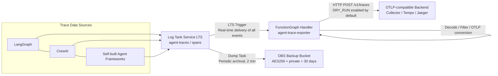

# Agent Trace Exporter

[](./)
[](https://www.huaweicloud.com/)
[](./infra/)
[](./src/)
[](./docs/architecture.md)
[](./LICENSE)

> Extracts trace spans written by agent runtimes and frameworks to a log service in real time, filters them by attributes, converts them to OTLP format, and fans them out to any OTLP-compatible backend; matched records are archived to object storage for 30 days. Suitable for observability integration of agent frameworks such as LangGraph / CrewAI and self-built agent services.

---

## 2. Introduction / Overview

This solution provides a "log → OTLP" agent trace export pipeline: the agent runtime writes trace spans as JSON to the Log Tank Service (LTS); the pipeline consumes them in real time and filters them by configurable attributes, converts matched spans to OpenTelemetry (OTLP) format, and fans them out to one or more OTLP-compatible backends (self-hosted Collector, Grafana Tempo, Jaeger, etc.), while periodically archiving raw records to Object Storage Service (OBS) with a 30-day retention period.

**Problem solved**: Trace data from agent frameworks (LangGraph / CrewAI, etc.) and self-built agent services is scattered across logs and lacks a unified OTLP egress; this solution provides a zero-intrusion, log-side pipeline that connects to any OTLP ecosystem without modifying business code.

**Intended audience**: Development and operations teams that need to connect agent applications to a tracing backend.

---

## 3. Table of Contents

- [Chapter 1 Title and Badges](#agent-trace-exporter)
- [Chapter 2 Introduction / Overview](#2-introduction--overview)
- [Chapter 3 Table of Contents](#3-table-of-contents)
- [Chapter 4 Architecture Design](#4-architecture-design)
- [Chapter 5 Solution Highlights](#5-solution-highlights)
- [Chapter 6 Cloud Services Involved](#6-cloud-services-and-costs)
- [Chapter 7 Prerequisites](#7-prerequisites)
- [Chapter 8 Quick Start / One-Click Deployment](#8-quick-start--one-click-deployment)
- [Chapter 9 Step-by-Step Deployment](#9-step-by-step-deployment)
- [Chapter 10 Usage / Verification](#10-usage--verification)
- [Chapter 11 Resource Cleanup](#11-resource-cleanup)
- [Chapter 12 Detailed Description](#12-detailed-description)
- [Chapter 13 Dependencies and Acknowledgments](#13-dependencies-and-acknowledgments)
- [Chapter 14 FAQ / Troubleshooting](#14-faq--troubleshooting)
- [Chapter 15 Contributing Guidelines](#15-contributing-guidelines)
- [Chapter 16 License](#16-license)
- [Chapter 17 Submitter](#17-Submitter)

---

## 4. Architecture Design



**Core pipeline**: `Log write (LTS) → Real-time trigger (FunctionGraph) → Filter and convert (OTLP) → Fan out to backends + Archival backup (OBS)`. The real-time export path and the archival backup path are decoupled and never block each other.

---

## 5. Solution Highlights

| Highlight | Description |
|---|---|
| Zero-dependency handler | OTLP JSON encoding implemented with the standard library; delivered as inline code, no dependency package build/upload needed |
| Zero-intrusion integration | Agents only need to write logs; no business code changes required |
| Multi-endpoint fan-out | The `otlp_endpoints` JSON array supports delivering to multiple OTLP backends simultaneously |
| Secure defaults | `dry_run="true"` logs without sending; OBS private + encrypted + public access fully blocked |
| Configurable filtering | Exact / prefix / multi-value attribute filtering, with allow-all by default |
| Extremely low cost | Fully usage-based billing, no fixed-specification resources; ≈ ¥0 when idle |

---

## 6. Cloud Services and Costs

| Cloud Service | Purpose |
|---|---|
| Log Tank Service (LTS) | Span log ingestion and archival source |
| FunctionGraph | Trace handler function (decode/filter/OTLP) |
| Object Storage Service (OBS) | Backup of matched records (30 days) |
| IAM | Function agency (read LTS + write OBS) |

---

## 7. Prerequisites

| Item | Requirement |
|---|---|
| Huawei Cloud account | Permissions to create LTS, FunctionGraph, OBS, and IAM resources |
| Region | Defaults to `cn-north-4` (CN North-Beijing 4), adjustable |
| Tools | Terraform ≥ 1.5; `huaweicloud` provider ≥ 1.97 (see `infra/` for the offline plugin directory) |
| Credentials | Inject runtime temporary credentials via environment variables (never written to disk or committed to the repository) |
| OTLP endpoint | One or more OTLP-compatible backend addresses |

---

## 8. Quick Start / One-Click Deployment

```bash
cd infra
cp terraform.tfvars.example terraform.tfvars    # Edit obs_bucket_name, etc.
terraform init -backend=false -plugin-dir=<plugin-cache-dir>
terraform validate
terraform apply
```

Once the apply completes, the `agent-trace-exporter` function is subscribed to the `agent-traces/spans` log stream, and spans written by agents automatically enter the pipeline. **By default `dry_run=true`, which only logs without sending**; turn it off after confirming the pipeline works.

---

## 9. Step-by-Step Deployment

**Step 1 — Prepare the variables**

```bash
cd infra
cp terraform.tfvars.example terraform.tfvars
# Edit: obs_bucket_name (must be globally unique); set filter_span_attributes / otlp_endpoints as needed
```

**Step 2 — Initialize and validate**

```bash
terraform init -backend=false -plugin-dir=<plugin-cache-dir>
terraform validate
```

Expected output: `Success! The configuration is valid.`

**Step 3 — Review the execution plan**

```bash
terraform plan
```

Expected output: 8 resources to create (LTS group/stream, function, trigger, dump task, OBS bucket, public-access block, agency).

**Step 4 — Apply the deployment**

```bash
terraform apply
```

Expected output: `Apply complete!`, plus the outputs `function_urn`, `log_group_id`, `log_stream_id`, `obs_backup_bucket`.

**Step 5 — Configure endpoint headers (optional)**

If the OTLP backend requires authentication headers, update the encrypted field `OTEL_EXPORTER_OTLP_HEADERS` in the FunctionGraph console → Function → "Configuration" → "Environment Variables" (e.g., `Authorization=Bearer <TOKEN>`).

---

## 10. Usage / Verification

### Minimal Example

The pipeline is triggered as soon as the agent runtime writes a single-line JSON span to the `agent-traces/spans` log stream:

```json
{
  "traceId": "0af7651916cd43dd8448eb211c80319c",
  "spanId": "b7ad6b7169203331",
  "name": "agent.plan",
  "kind": "INTERNAL",
  "startTimeUnixNano": "1544712660000000000",
  "endTimeUnixNano": "1544712661000000000",
  "attributes": {"service.name": "demo-agent", "agent.origin": "sample.agent.runtime"}
}
```

### Verification Methods

1. **Local verification of function logic** (offline, zero dependencies):
   ```bash
   cd src/functions/exporter && python3 -m unittest discover -s tests -v
   ```
   Expected: `Ran 9 tests ... OK`.

2. **End-to-end verification** (in the cloud): After confirming `dry_run="false"`, write a test span and observe in the FunctionGraph logs:
   - `Exporting N spans` / `Exported M resource spans (K bytes) to <endpoint>`
   - Summary returned: `{"processed": 1, "matched": 1, "dropped": 0, "failed": 0}`

3. **Backend confirmation**: Query the OTLP backend to check whether the trace has arrived.

4. **Backup confirmation**: Wait 2–5 minutes and check that time-partitioned archive objects appear under the `traces/` prefix in the OBS bucket.

5. **Filter verification** (optional): Set `filter_span_attributes="agent.origin=sample.agent.*"`; matching spans are exported and non-matching ones are dropped (`matched` does not increase).

---

## 11. Resource Cleanup

```bash
cd infra
terraform destroy
```

> ⚠️ By default `force_destroy=false`: if archive objects still exist in the OBS bucket, the destroy will fail (data protection). After confirming the backups are no longer needed, delete the objects in the bucket or explicitly set `force_destroy=true` before destroying.

---

## 12. Detailed Description

### 12.1 Architecture Components

| Component | Service | Responsibility |
|---|---|---|
| Log entry | LTS (`agent-traces`/`spans`) | Agent runtime writes JSON spans |
| Trigger | FunctionGraph LTS trigger | Delivers new log stream events to the function in real time |
| Handler function | FunctionGraph (Python 3.10) | Decode → filter → OTLP conversion → fan-out |
| Archival | LTS dump task | Periodically (2 min) archives logs to OBS |
| Backup bucket | OBS | `traces/` prefix, AES256 encryption, private, 30-day expiry |
| Permissions | IAM agency | Function reads LTS + writes OBS |

### 12.2 Configuration Items (`infra/terraform.tfvars`)

| Variable | Default | Description |
|---|---|---|
| `region` | `cn-north-4` | Deployment region |
| `log_group_name` / `log_stream_name` | `agent-traces` / `spans` | Log group / log stream names |
| `obs_bucket_name` | `agent-trace-exporter-backup` | Backup bucket name (globally unique) |
| `backup_retention_days` | `30` | Backup retention days |
| `filter_span_attributes` | `*` | Attribute filter expression (`key=v1\|v2`; trailing `*` for prefix matching) |
| `otlp_encoding` | `json` | OTLP encoding: `json` (zero dependencies) / `protobuf` (requires a dependency package) |
| `otlp_endpoints` | `[]` | Multi-endpoint JSON array (fan-out) |
| `otlp_endpoint` | empty | Single-endpoint fallback |
| `dry_run` | `true` | Log without sending (secure default) |
| `function_dependencies` | `[]` | Dependency package ID for protobuf encoding |

### 12.3 Function Processing Flow

`Event envelope normalization → span extraction (single/batch) → attribute filtering (exact/prefix/multi-value) → OTLP JSON normalization → multi-endpoint HTTP fan-out`; the `Ok / Dropped / ProcessingFailed` three-state disposition protocol is preserved throughout, and the returned summary includes `processed / matched / dropped / failed` counts.

### 12.4 Documentation Index

| Document | Content |
|---|---|
| [`docs/architecture.md`](docs/architecture.md) | Architecture description and component inventory |
| [`docs/deployment-guide.md`](docs/deployment-guide.md) | Deployment / integration / verification / cleanup guide |
| [`docs/deployment-verification-report.md`](docs/deployment-verification-report.md) | Real Huawei Cloud deployment verification report (including FSS.1501 root cause analysis) |
| [`docs/response-constraints.md`](docs/response-constraints.md) | Quality gate C1–C10 checklist |

---

## 13. Dependencies and Acknowledgments

- Runtime: Python 3.10 (standard library implementation, zero third-party dependencies by default)
- Protocol: OpenTelemetry OTLP (`/v1/traces`; HTTP/JSON by default, HTTP/protobuf optional)
- IaC: Terraform + the `huaweicloud` provider
- Acknowledgments: The OpenTelemetry community (OTLP specification and protobuf definitions)

---

## 14. FAQ / Troubleshooting

**Q1: Function logs show `failed: 1`?**
The endpoint is not configured or unreachable. Check `otlp_endpoints` / `otlp_endpoint` and confirm network reachability; keep `dry_run="true"` for temporary troubleshooting.

**Q2: `matched: 0` even though spans were definitely written?**
The filter condition did not match. Set `filter_span_attributes` to `*` (allow all) to verify; note that prefix matching requires a trailing `*`.

**Q3: No archives appear in the OBS bucket for a long time?**
The dump task runs on a 2-minute cycle — wait first; then check whether the dump status is enabled and whether the agency has OBS permissions.

**Q4: How do I switch to protobuf encoding?**
Run `src/tools/build-dependency.sh` to build the dependency package, create the dependency in the FunctionGraph console, fill the dependency ID into `function_dependencies`, and set `otlp_encoding="protobuf"`.

**Q5: `terraform destroy` fails?**
The OBS bucket is not empty. After confirming the backups are no longer needed, delete the objects in the bucket, or temporarily set `force_destroy=true`.

---

## 15. Contributing Guidelines

Issues and PRs are welcome. Please read `docs/` first to understand the architecture and quality gates (C1–C10) before contributing.

---

## 16. License

This repository is released under the [MIT-0](LICENSE) license (see the badge at the top). Use of this project constitutes acceptance of its terms.

---

## 17. Submitter

- **Submitter**: zhangcheng123321
