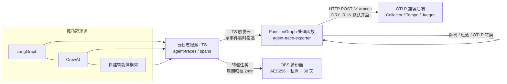

# 智能体链路导出器

[](./)
[](https://www.huaweicloud.com/)
[](./infra/)
[](./src/)
[](./docs/architecture.md)
[](./LICENSE)

> 将智能体运行时与框架写入日志服务的链路 span，实时抽取、按属性过滤、转 OTLP 格式并扇出到任意 OTLP 兼容后端，命中记录归档对象存储 30 天。适用于 LangGraph / CrewAI 等智能体框架与自建智能体服务的可观测性接入。

---

## 2. 简介 / 概述

本方案提供一套「日志 → OTLP」的智能体链路导出管道：智能体运行时将 trace span 以 JSON 写入云日志服务（LTS），管道实时消费并按可配置属性过滤，将匹配的 span 转换为 OpenTelemetry（OTLP）格式后扇出到一个或多个 OTLP 兼容后端（自建 Collector、Grafana Tempo、Jaeger 等），同时将原始记录周期归档到对象存储（OBS）并保留 30 天。

**解决的问题**：智能体框架（LangGraph / CrewAI 等）与自建智能体服务的链路数据散落在日志中，缺少统一的 OTLP 出口；本方案提供零侵入的日志侧管道，无需改造业务代码即可对接任意 OTLP 生态。

**适用对象**：需要为智能体应用接入链路追踪后端的开发与运维团队。

---

## 3. 目录

- [第 1 章 标题与徽章](#智能体链路导出器)
- [第 2 章 简介 / 概述](#2-简介--概述)
- [第 3 章 目录](#3-目录)
- [第 4 章 架构设计](#4-架构设计)
- [第 5 章 方案亮点](#5-方案亮点)
- [第 6 章 涉及云服务](#6-涉及云服务)
- [第 7 章 前置条件](#7-前置条件)
- [第 8 章 快速开始 / 一键部署](#8-快速开始--一键部署)
- [第 9 章 分步部署](#9-分步部署)
- [第 10 章 使用方法 / 验证](#10-使用方法--验证)
- [第 11 章 清理资源](#11-清理资源)
- [第 12 章 详细说明](#12-详细说明)
- [第 13 章 依赖与致谢](#13-依赖与致谢)
- [第 14 章 FAQ / 故障排除](#14-faq--故障排除)
- [第 15 章 贡献指南](#15-贡献指南)
- [第 16 章 许可证](#16-许可证)
- [第 17 章 提交者](#17-提交者)

---

## 4. 架构设计



**核心链路**：`日志写入（LTS）→ 实时触发（FunctionGraph）→ 过滤转换（OTLP）→ 扇出后端 + 归档备份（OBS）`。实时导出与归档备份双路径解耦，互不阻塞。

---

## 5. 方案亮点

| 亮点 | 说明 |
|---|---|
| 零依赖处理函数 | 标准库实现 OTLP JSON 编码，内联代码交付，无需依赖包构建/上传 |
| 零侵入接入 | 智能体仅需写日志，无需改造业务代码 |
| 多端点扇出 | `otlp_endpoints` JSON 数组支持同时投递多个 OTLP 后端 |
| 安全默认 | `dry_run="true"` 仅记录不发送；OBS 私有 + 加密 + 公网访问全封 |
| 过滤可配置 | 精确 / 前缀 / 多值属性过滤，默认全放行 |
| 成本极低 | 全按用量计费，无固定规格资源，闲置时 ≈ ¥0 |

---

## 6. 涉及云服务与费用

| 云服务 | 用途 |
|---|---|---|
| 云日志服务 LTS | span 日志写入与归档源 |
| FunctionGraph | 链路处理函数（解码/过滤/OTLP） |
| 对象存储服务 OBS | 命中记录备份（30 天） |
| IAM | 函数委托（读 LTS + 写 OBS） |

---

## 7. 前置条件

| 项 | 要求 |
|---|---|
| 华为云账号 | 具备 LTS、FunctionGraph、OBS、IAM 创建权限 |
| 区域 | 默认 `cn-north-4`（华北-北京四），可调整 |
| 工具 | Terraform ≥ 1.5；`huaweicloud` provider ≥ 1.97（离线插件目录见 `infra/`） |
| 凭据 | 以环境变量注入运行期临时凭据（不落盘、不提交到仓库） |
| OTLP 端点 | 一个或多个 OTLP 兼容后端地址 |

---

## 8. 快速开始 / 一键部署

```bash
cd infra
cp terraform.tfvars.example terraform.tfvars    # 编辑 obs_bucket_name 等
terraform init -backend=false -plugin-dir=<plugin-cache目录>
terraform validate
terraform apply
```

应用完成后，函数 `agent-trace-exporter` 即已订阅 `agent-traces/spans` 日志流，智能体写入 span 后自动进入管道。**默认 `dry_run=true`，仅记录不发送**，确认链路后再关闭。

---

## 9. 分步部署

**步骤 1 — 准备变量**

```bash
cd infra
cp terraform.tfvars.example terraform.tfvars
# 编辑：obs_bucket_name（需全局唯一）、按需设置 filter_span_attributes / otlp_endpoints
```

**步骤 2 — 初始化与校验**

```bash
terraform init -backend=false -plugin-dir=<plugin-cache目录>
terraform validate
```

预期输出：`Success! The configuration is valid.`

**步骤 3 — 查看执行计划**

```bash
terraform plan
```

预期输出：8 个资源待创建（LTS 组/流、函数、触发器、转储、OBS 桶、公网封禁、委托）。

**步骤 4 — 应用部署**

```bash
terraform apply
```

预期输出：`Apply complete!`，并输出 `function_urn`、`log_group_id`、`log_stream_id`、`obs_backup_bucket`。

**步骤 5 — 配置端点头部（可选）**

OTLP 后端需要鉴权头时，在 FunctionGraph 控制台 → 函数 →「配置」→「环境变量」中更新加密字段 `OTEL_EXPORTER_OTLP_HEADERS`（如 `Authorization=Bearer <TOKEN>`）。

---

## 10. 使用方法 / 验证

### 最简示例

智能体运行时向 `agent-traces/spans` 日志流写入一行 JSON span 即可触发管道：

```json
{
  "traceId": "0af7651916cd43dd8448eb211c80319c",
  "spanId": "b7ad6b7169203331",
  "name": "agent.plan",
  "kind": "INTERNAL",
  "startTimeUnixNano": "1544712660000000000",
  "endTimeUnixNano": "1544712661000000000",
  "attributes": {"service.name": "demo-agent", "agent.origin": "sample.agent.runtime"}
}
```

### 验证方法

1. **函数逻辑本地验证**（离线，零依赖）：
   ```bash
   cd src/functions/exporter && python3 -m unittest discover -s tests -v
   ```
   预期：`Ran 9 tests ... OK`。

2. **端到端验证**（云端）：确认 `dry_run="false"` 后写入测试 span，在 FunctionGraph 日志中观察：
   - `Exporting N spans` / `Exported M resource spans (K bytes) to <endpoint>`
   - 返回摘要 `{"processed": 1, "matched": 1, "dropped": 0, "failed": 0}`

3. **后端确认**：在 OTLP 后端查询该 trace 是否到达。

4. **备份确认**：等待 2–5 分钟，检查 OBS 桶 `traces/` 前缀下出现按时间分目录的归档对象。

5. **过滤验证**（可选）：设 `filter_span_attributes="agent.origin=sample.agent.*"`，匹配的 span 导出、不匹配的被丢弃（`matched` 不增加）。

---

## 11. 清理资源

```bash
cd infra
terraform destroy
```

> ⚠️ 默认 `force_destroy=false`：若 OBS 桶中仍有归档对象，销毁将失败（保护数据）。确认不再需要备份后，再删除桶内对象或显式开启 `force_destroy=true` 后销毁。

---

## 12. 详细说明

### 12.1 架构组件

| 组件 | 服务 | 职责 |
|---|---|---|
| 日志入口 | LTS（`agent-traces`/`spans`） | 智能体运行时写入 JSON span |
| 触发器 | FunctionGraph LTS 触发器 | 日志流新事件实时投递到函数 |
| 处理函数 | FunctionGraph（Python 3.10） | 解码 → 过滤 → OTLP 转换 → 扇出 |
| 归档 | LTS 转储任务 | 周期（2min）归档日志到 OBS |
| 备份桶 | OBS | traces/ 前缀，AES256 加密、私有、30 天过期 |
| 权限 | IAM 委托 | 函数读 LTS + 写 OBS |

### 12.2 配置项（`infra/terraform.tfvars`）

| 变量 | 默认 | 说明 |
|---|---|---|
| `region` | `cn-north-4` | 部署区域 |
| `log_group_name` / `log_stream_name` | `agent-traces` / `spans` | 日志组 / 日志流名称 |
| `obs_bucket_name` | `agent-trace-exporter-backup` | 备份桶名（全局唯一） |
| `backup_retention_days` | `30` | 备份保留天数 |
| `filter_span_attributes` | `*` | 属性过滤表达式（`key=v1\|v2`，尾缀 `*` 前缀匹配） |
| `otlp_encoding` | `json` | OTLP 编码：`json`（零依赖）/ `protobuf`（需依赖包） |
| `otlp_endpoints` | `[]` | 多端点 JSON 数组（扇出） |
| `otlp_endpoint` | 空 | 单端点兜底 |
| `dry_run` | `true` | 仅记录不发送（安全默认） |
| `function_dependencies` | `[]` | protobuf 编码时的依赖包 ID |

### 12.3 函数处理流程

`事件信封归一化 → span 提取（单条/批次）→ 属性过滤（精确/前缀/多值）→ OTLP JSON 归一化 → 多端点 HTTP 扇出`；全程保留 `Ok / Dropped / ProcessingFailed` 三态处置协议，返回摘要含 `processed / matched / dropped / failed` 计数。

### 12.4 文档索引

| 文档 | 内容 |
|---|---|
| [`docs/architecture.md`](docs/architecture.md) | 架构说明与组件清单 |
| [`docs/deployment-guide.md`](docs/deployment-guide.md) | 部署 / 接入 / 验证 / 清理指导 |
| [`docs/deployment-verification-report.md`](docs/deployment-verification-report.md) | 华为云真实部署验证报告（含 FSS.1501 根因分析） |
| [`docs/response-constraints.md`](docs/response-constraints.md) | 质量门禁 C1–C10 核对表 |

---

## 13. 依赖与致谢

- 运行时：Python 3.10（标准库实现，默认零第三方依赖）
- 协议：OpenTelemetry OTLP（`/v1/traces`，HTTP/JSON 默认、HTTP/protobuf 可选）
- IaC：Terraform + `huaweicloud` provider
- 致谢：OpenTelemetry 社区（OTLP 规范与 protobuf 定义）

---

## 14. FAQ / 故障排除

**Q1：函数日志显示 `failed: 1`？**
端点未配置或不可达。检查 `otlp_endpoints` / `otlp_endpoint`，确认网络可达；临时排查可保持 `dry_run="true"`。

**Q2：`matched: 0` 但确实写入了 span？**
过滤条件未命中。将 `filter_span_attributes` 置 `*` 全放行验证；注意前缀匹配需尾缀 `*`。

**Q3：OBS 桶中迟迟没有归档？**
转储任务周期为 2min，先等待；再检查转储状态是否为启用、委托是否有 OBS 权限。

**Q4：如何切换 protobuf 编码？**
运行 `src/tools/build-dependency.sh` 构建依赖包，在 FunctionGraph 控制台创建依赖后，将依赖 ID 填入 `function_dependencies`，并设 `otlp_encoding="protobuf"`。

**Q5：`terraform destroy` 失败？**
OBS 桶非空。确认备份不再需要后删除桶内对象，或临时设 `force_destroy=true`。

---

## 15. 贡献指南

欢迎提交 Issue 与 PR。建议先阅读 `docs/` 了解架构与质量门禁（C1–C10）后参与贡献。

---

## 16. 许可证

本仓库以 [MIT-0](LICENSE) 许可证发布（顶部徽章见标题区）。使用本项目即表示同意其条款。

---

## 17. 提交者

- **提交者**：zhangcheng123321
